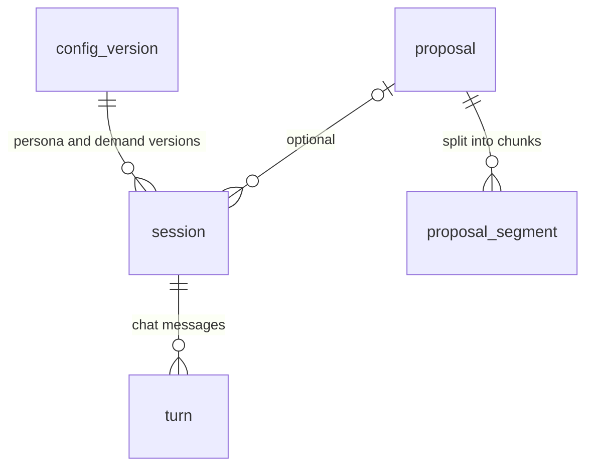

# Data model

The system remembers things in **5 tables** (PostgreSQL in real use, SQLite in tests). This page explains each table, each column and why it is there. The source of truth is `app/db/models.py`. The migration is `alembic/versions/0001_initial.py`, which creates exactly these 5 tables (it replaces the earlier three migrations, since nothing is deployed yet). If you ran the older migrations, delete your local database and run `alembic upgrade head` again.

**What was removed, and why.** Users, scoring, review, reports, the AI-call log and the audit log are not being built now, so their tables were removed (they were in the first draft of the schema): `app_user`, `assessment`, `assessment_evidence`, `review`, `report`, `llm_call_log`, `audit_log`. They come back, through a new migration, when those features are built. The data shapes for scoring and the program's result format are still in `app/schemas/` for that work.

Plain-words key:
- **id**: every table has one. A unique row number (a UUID).
- **-> table**: this column points at a row in another table (a "foreign key"). The database refuses a value that does not exist there.
- **JSON**: a column holding a small structured document instead of a single value.
- **Never edited**: rows that are only ever added, so the record cannot be quietly changed.
- **`*_ref`**: a plain text name of the logged-in user (the `X-Dev-User` header for now). There is no user table; real login arrives later.

## Changes after the architect call (05-Nov)
The call changed what the system is for. It is a strict-client round, in effect a managerial round. The agent compares the **demand** (what the project needs, given by the Gama team) with the trainee's **profile** (their resume), and asks questions that fit both. It gets tougher or easier by itself depending on how the trainee answers. The technical interview is a different agent, and the trainees' training history is a background process. Neither is ours.

**Built**
| What was said | What changed in the tables |
|---|---|
| The **demand** comes from the Gama team as master data. The agent always knows it | New `config_version` kind `demand`. **One demand for everyone**: the most recently saved published one is used. `session.demand_version_id` records which version a chat started with |
| **Scenarios are not configured by an admin.** The agent works out the level of questioning itself, from a one-time dataset | Scenarios stay in `config_version` (our database), loaded in bulk. The trainee no longer picks one, so `session.scenario_version_id` is now **empty for new sessions** (the column is kept, optional) |
| A chat **ends only at `max_turns`** (plus `grace_turns` while answers improve), or when someone ends it | The "all checklist items covered" ending was removed. `end_reason` `concerns_resolved` is no longer produced |
| The profile is the main input of a chat | `session.proposal_id` is still empty-able in the table (old rows), but the API now **requires** a ready one |
| The **persona** stays configurable | No change |

**Not built yet**
- The trainee uploads **only a profile (resume)**: 1 to 3 pages, PDF, DOCX or TXT, no images, figures or scans. So `proposal` is really a profile, and OCR is not needed (`proposal_segment.kind = ocr` and `ocr_confidence` stay unused). Renaming `proposal` to `profile` (and the `/proposals` paths to `/profiles`) is deferred until Kedar agrees, because the ingestion code he is writing uses the current names.
- The `brief` should become a short profile summary (skills, roles, projects, years) instead of "claims and weak points". That is Kedar's part.
- Whether the scenario dataset should instead live in the agent's own store (Shubra's side). For now it is in our table and is passed to the agent.

## How the tables connect (today)

## Settings

### `config_version` - every saved persona, scenario and demand
One table holds all three kinds, because they work the same way: each change saves a **new numbered version**. Personas and the demand are edited by an admin; scenarios are loaded in bulk. Published rows are never changed, so an old chat can always be explained by the exact settings it used.
| Column | Why it is there |
|---|---|
| `kind` | `persona` (the AI client), `scenario` (a situation the client can raise, with its objections) or `demand` (what the project needs and expects, from the Gama team). |
| `key` | A stable name for the thing, for example `verma-strict` or `vendor-delay`. |
| `version_no` | 1, 2, 3... for each edit of that key. Together `kind` + `key` + `version_no` must be unique. |
| `status` | `draft` (still being edited), `published` (usable), `retired` (replaced by a newer published version). |
| `config` | All the settings as JSON. The shape is checked by `PersonaConfig`, `ScenarioConfig` or `DemandConfig` before saving. |
| `created_at` | When this version was saved. |

## The uploaded proposal

### `proposal` - an uploaded file and what we learned from it
| Column | Why it is there |
|---|---|
| `owner_ref` | Whose file it is (the login user). Access control: a trainee sees only their own. |
| `filename`, `file_type` | `filename` for display. `file_type` (`pdf`, `docx`, `txt`) picks the right reader. |
| `sha256` | A fingerprint of the file. Spots a duplicate upload so we reuse the earlier summary. |
| `blob_uri` | Where the original file is stored (a folder in development). The file is kept out of the database. |
| `status` | `queued`, `extracting`, `ready` or `failed`. The UI watches this. |
| `brief` | The structured summary of the proposal (claims, weak points, each citing chunk ids), as JSON. Empty until `ready`. |
| `error` | Why it failed, if it did. |
| `created_at` | Also starts the 30-day deletion clock. |

### `proposal_segment` - the proposal cut into numbered chunks
Each chunk can be pointed at, so the persona can cite one and code can check it exists.
| Column | Why it is there |
|---|---|
| `proposal_id` -> `proposal` | The proposal it belongs to. Deleted along with it. |
| `seq` | The chunk's order (unique within a proposal). |
| `page` | The page number (1 for plain text files). |
| `kind` | `text` (read directly) or `ocr` (read from an image of text). |
| `text` | The chunk itself. |
| `ocr_confidence` | How sure the OCR was (0 to 1). Empty for normal text. |

## The chat

### `session` - one roleplay run by one trainee
| Column | Why it is there |
|---|---|
| `trainee_ref` | Who is playing (the login user). |
| `proposal_id` -> `proposal` | The trainee's profile. The API requires one that is `ready`; the column can be empty only on old rows. |
| `persona_version_id` -> `config_version` | The exact persona version used. |
| `demand_version_id` -> `config_version` | The exact demand version the chat started with. May be empty. |
| `scenario_version_id` -> `config_version` | No longer set: the agent picks scenarios itself. Old sessions keep their value. |
| `status` | `active` or `ended`. |
| `end_reason` | Why it ended: trainee ended it, turn limit, all checklist items covered, time limit, or admin. |
| `started_at`, `ended_at` | Timing. `ended_at` starts the 30-day deletion clock. |

### `turn` - the chat, one row per message. Never edited.
The full record of the conversation, and what any later score will be traced back to.
| Column | Why it is there |
|---|---|
| `session_id` -> `session` | Which session. |
| `idx` | Position in the chat: 0, 1, 2... unique per session. (The program's result format numbers messages from 1, so result turn = `idx` + 1.) |
| `role` | `persona` (the AI client, called "client" in the result format) or `trainee`. |
| `content` | The message text. |
| `escalation_level` | How tough the client was in that reply, step 1 to 4. Only on persona rows. Also gives the "current level" without extra state. |
| `refs` | The proposal chunks the client's question relied on. Only on persona rows. Code keeps only real chunk ids. |
| `evaluation` | The agent's judgement of a trainee answer: quality, which checklist items it met, whether it was evasive, a short quote. Only on trainee rows. Admins can see it; trainees cannot. |
| `idempotency_key` | A token the app sends with each message so a retry cannot create a duplicate. Trainee rows only. |
| `created_at` | Order and timing. |

## What we deliberately do not store
- Passwords, names or emails.
- API keys.
- A separate copy of the "current escalation level" or "open checklist items". They are worked out from the saved turns, so there is nothing to get out of sync.

## Deletion
A nightly job (not written yet) will delete data 30 days after a session ends, or 30 days after an upload that was never used. Deleting a session removes its turns. A proposal still used by a session is never deleted, and the API refuses to delete it.

## Looking at the tables on your machine
| Option | Needs Docker? | How |
|---|---|---|
| **Adminer** (browser) | yes | `docker compose up -d`, open http://localhost:8080. System: PostgreSQL, Server: `postgres`, User/Password/Database: `podc`. Run `uv run alembic upgrade head` first. |
| **DBeaver** or **pgAdmin** (desktop) | yes | Connect to `localhost:5432`, user `podc`, password `podc`, database `podc`. |
| **DB Browser for SQLite** or the VS Code "SQLite Viewer" extension | **no** | Set `PODC_DATABASE_URL=sqlite:///local.db`, run `uv run alembic upgrade head`, then open `local.db`. |
| **The diagram above** | no | Opens as a picture on GitHub and in the VS Code Markdown preview. |
