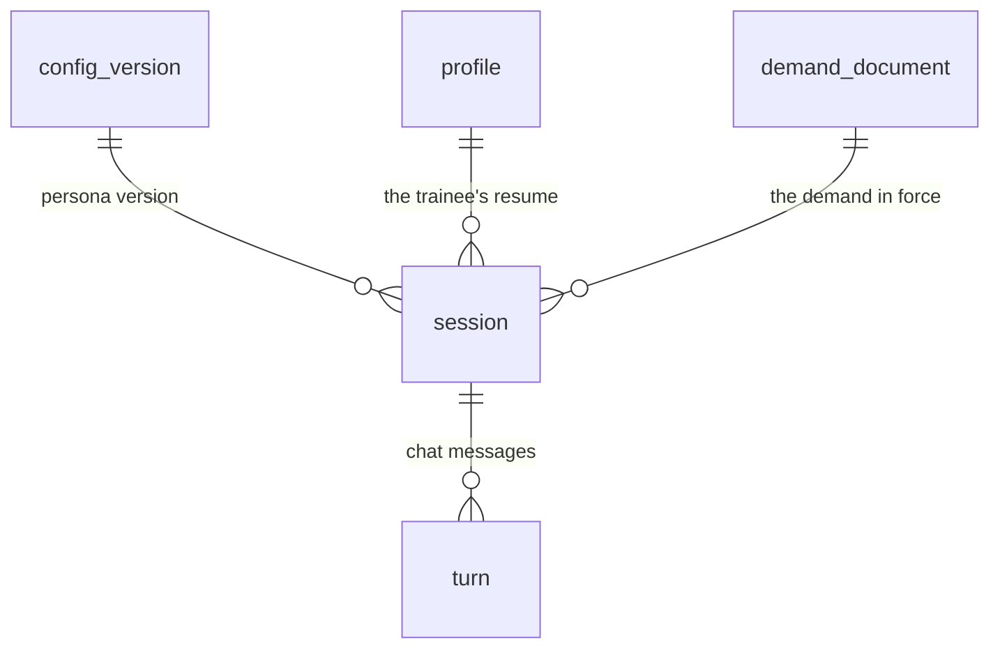

# Data model

The system remembers things in **5 tables** (PostgreSQL in real use, SQLite in tests). This page explains each table, each column and why it is there. The source of truth is `app/db/models.py`. The migration is `alembic/versions/0001_initial.py`, which creates exactly these 5 tables (it replaces the earlier migrations, since nothing is deployed yet). If you ran an older version, delete your local database and run `alembic upgrade head` again.

**What was removed, and why.** The tables for users, scoring, review, reports, the AI-call log and the audit log are not there (they were in the first draft of the schema): `app_user`, `assessment`, `assessment_evidence`, `review`, `report`, `llm_call_log`, `audit_log`. The current plan does not restore dedicated scoring, review, or report tables. Scoring and reports use the pinned settings and transcript as inputs; report artifacts are produced separately. If durable review history or score snapshots become a requirement, decide how to store them before adding schema or migrations. Shared scoring and result contracts live in `app/schemas/`.
Plain-words key:
- **id**: every table has one. A unique row number (a UUID).
- **-> table**: this column points at a row in another table (a "foreign key"). The database refuses a value that does not exist there.
- **JSON**: a column holding a small structured document instead of a single value.
- **Never edited**: rows that are only ever added, so the record cannot be quietly changed.
- **`*_ref`**: a plain text name of the logged-in user (the `X-Dev-User` header for now). There is no user table; real login arrives later.

## What the system is for (architect call, 05-Nov)
A strict-client round, in effect a managerial round. The agent compares the **demand** (what the project needs, an admin uploads it; it comes from the Gama team) with the trainee's **profile** (their resume, uploaded by the trainee), and asks questions that fit both. It gets tougher or easier by itself depending on how the trainee answers, choosing from a one-time dataset of **scenarios**. The technical interview is a different agent, and the trainees' training history is a background process. Neither is ours.

How that shows up in the tables:
- **Two plain uploads, no chunking.** There is no segment table or source-document chunk citations. The pipeline reads each file and saves extracted text as JSON in the row's `content` column. Today the shape is `{"text": "<markdown>"}`, including headings, lists, tables and, for PDFs, `<!-- page N -->` page markers. The agent receives this content as-is. Scoring evidence can cite transcript exchanges; these are distinct from document citations.
- **One demand for everyone:** the newest demand document that is `ready`.
- **Scenarios are not configured by hand.** They are loaded in bulk once (an admin sends the whole dataset). The trainee does not pick one.
- **A chat ends only at `max_turns`** (plus `grace_turns` while answers are improving), or when someone ends it.
- **Personas are configurable**: each client has its own escalation ladder.

Still open: whether the scenario dataset should instead live in the agent's own store (Shubra's side). For now it is in our table and is passed to the agent.

## How the tables connect

Scenarios are in `config_version` too, but a session does not point at one: the agent reads them all.

## Settings

### `config_version` - every saved persona and scenario
One table holds both kinds, because they work the same way: each change saves a **new numbered version**. Personas are edited by an admin; scenarios are loaded in bulk. Published rows are never changed, so an old chat can always be explained by the exact settings it used.
| Column | Why it is there |
|---|---|
| `kind` | `persona` (the AI client) or `scenario` (a situation the client can raise, with its objections). |
| `key` | A stable name for the thing, for example `verma-strict` or `vd-01`. |
| `version_no` | 1, 2, 3... for each edit of that key. Together `kind` + `key` + `version_no` must be unique. |
| `status` | `draft` (still being edited), `published` (usable), `retired` (replaced by a newer published version). |
| `config` | All the settings as JSON. The shape is checked by `PersonaConfig` or `ScenarioConfig` before saving. |
| `created_at` | When this version was saved. |

## The two uploads

### `profile` - a trainee's resume
| Column | Why it is there |
|---|---|
| `owner_ref` | Whose file it is (the login user). Access control: a trainee sees only their own. |
| `filename`, `file_type` | `filename` for display. `file_type` (`pdf`, `docx`, `txt`) picks the right reader. |
| `sha256` | A fingerprint of the file. Spots a duplicate upload so we reuse the earlier one. |
| `blob_uri` | Where the original file is stored (a folder in development). The file is kept out of the database. |
| `status` | `queued`, `extracting`, `ready` or `failed`. The UI watches this. |
| `content` | What the pipeline extracted, as JSON. Empty until `ready`. The agent receives it as it is. |
| `error` | Why it failed, if it did. |
| `created_at` | Also starts the 30-day deletion clock. |

### `demand_document` - the project demand, uploaded by an admin
Same idea as `profile`, but it is master data, not personal: `uploaded_by` (the admin) replaces `owner_ref`, and everyone's chats use the newest one that is `ready`. The other columns are the same: `filename`, `file_type`, `sha256`, `blob_uri`, `status`, `content` (the extracted JSON), `error`, `created_at`.

## The chat

### `session` - one roleplay run by one trainee
| Column | Why it is there |
|---|---|
| `trainee_ref` | Who is playing (the login user). |
| `profile_id` -> `profile` | The trainee's profile. The API requires one that is `ready`; the column can be empty only on old rows. |
| `persona_version_id` -> `config_version` | The exact persona version used. |
| `demand_id` -> `demand_document` | The demand document the chat started with. |
| `scenario_version_id` -> `config_version` | Not set any more: the agent picks scenarios itself. Kept so old rows load. |
| `status` | `active` or `ended`. |
| `end_reason` | Why it ended: trainee ended it, turn limit, time limit, or admin. (`concerns_resolved` is no longer produced.) |
| `started_at`, `ended_at` | Timing. `ended_at` starts the 30-day deletion clock. |

### `turn` - the chat, one row per message. Never edited.
The full record of the conversation, and what any later score will be traced back to.
| Column | Why it is there |
|---|---|
| `session_id` -> `session` | Which session. |
| `idx` | Position in the chat: 0, 1, 2... unique per session. (The program's result format numbers messages from 1, so result turn = `idx` + 1.) |
| `role` | `persona` (the AI client, called "client" in the result format) or `trainee`. |
| `content` | The message text. |
| `escalation_level` | How tough the client was in that reply, step 1 to 4. Only on persona rows. Also gives the "current level" without extra state. |
| `evaluation` | The agent's judgement of a trainee answer: quality, whether it was evasive, a short quote. Only on trainee rows. Admins can see it; trainees cannot. |
| `idempotency_key` | A token the app sends with each message so a retry cannot create a duplicate. Trainee rows only. |
| `created_at` | Order and timing. |

## What we deliberately do not store
- Passwords, names or emails.
- API keys.
- Chunks of the uploaded files, or citations to them (the documents are short and go to the agent whole).
- A separate copy of the "current escalation level". It is worked out from the saved turns, so there is nothing to get out of sync.

## Deletion
A nightly job (not written yet) will delete data 30 days after a session ends, or 30 days after an upload that was never used. Deleting a session removes its turns. A profile or demand document still used by a session is never deleted, and the API refuses to delete it.

## Looking at the tables on your machine
| Option | Needs Docker? | How |
|---|---|---|
| **Adminer** (browser) | yes | `docker compose up -d`, open http://localhost:8080. System: PostgreSQL, Server: `postgres`, User/Password/Database: `podc`. Run `uv run alembic upgrade head` first. |
| **DBeaver** or **pgAdmin** (desktop) | yes | Connect to `localhost:5432`, user `podc`, password `podc`, database `podc`. |
| **DB Browser for SQLite** or the VS Code "SQLite Viewer" extension | **no** | Set `PODC_DATABASE_URL=sqlite:///local.db`, run `uv run alembic upgrade head`, then open `local.db`. |
| **The diagram above** | no | Opens as a picture on GitHub and in the VS Code Markdown preview. |
