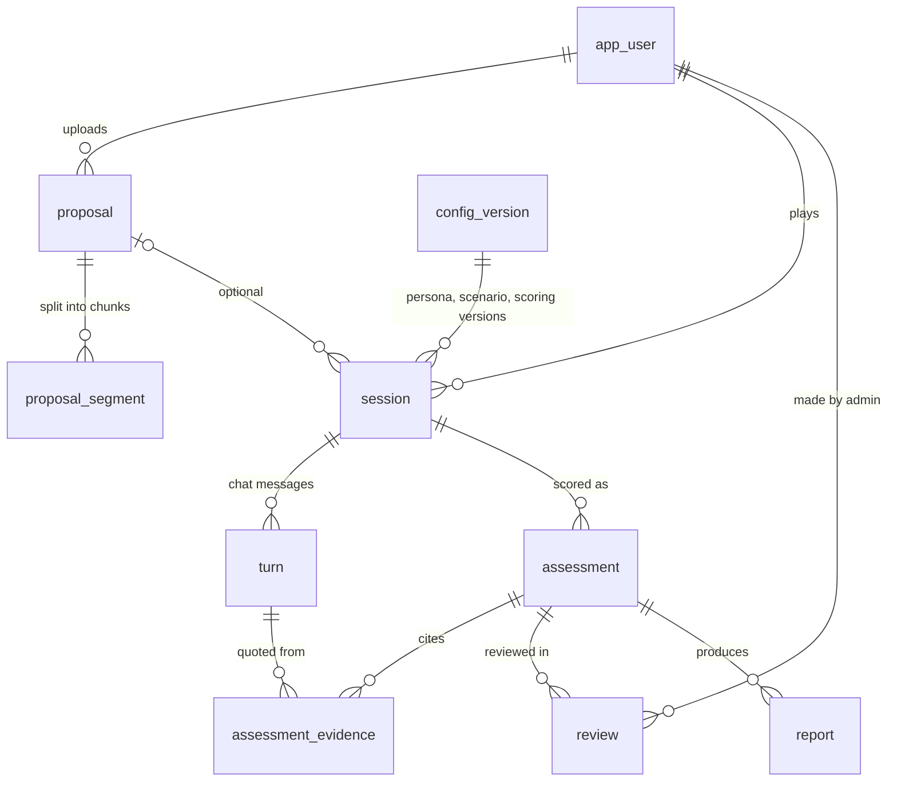

# Data model

The system remembers things in **12 tables** (PostgreSQL in real use, SQLite in tests). This page explains each table, each column and why it is there. The source of truth is `app/db/models.py`; the first migration is `alembic/versions/0001_initial.py`.

Plain-words key:
- **id**: every table has one. A unique row number (a UUID).
- **-> table**: this column points at a row in another table (a "foreign key"). The database refuses a value that does not exist there.
- **JSON**: a column holding a small structured document instead of a single value.
- **Never edited**: rows that are only ever added, so the record cannot be quietly changed.

## How the tables connect

`llm_call_log` and `audit_log` stand alone: they record what happened, and point at things by id.

## Group 1: people and settings

### `app_user` - who is using the system
| Column | Why it is there |
|---|---|
| `idp_sub` | The user's id in the company login system. It is how a returning person is recognised. We store no passwords and no names. |
| `trainee_ref` | A pseudonymous id (like `t_8f3a`) used when results leave this system, so a trainee's name never travels to other pods. Only trainees have one. |
| `cohort_id` | Which batch of trainees they belong to (for example `batch-07`). Used only to group results. |
| `created_at` | When we first saw them. |

### `config_version` - every saved persona, scenario and scoring setup
One table holds all three kinds, because they all work the same way: the admin edits, and each edit saves a **new numbered version**. Published rows are never changed, so an old score can always be explained by the exact settings it used.
| Column | Why it is there |
|---|---|
| `kind` | `persona` (the AI client), `scenario` (the situation and checklist) or `scoring_profile` (skills, weights, thresholds). |
| `key` | A stable name for the thing, for example `verma-strict` or `vendor-delay`. |
| `version_no` | 1, 2, 3... for each edit of that key. Together `kind` + `key` + `version_no` must be unique. |
| `status` | `draft` (still being edited), `published` (usable), `retired` (no longer offered). |
| `config` | All the settings as JSON. The shape is checked by `PersonaConfig`, `ScenarioConfig` or `ScoringConfig` before saving. |
| `created_at` | When this version was saved. |

## Group 2: the uploaded proposal

### `proposal` - an uploaded file and what we learned from it
| Column | Why it is there |
|---|---|
| `owner_id` -> `app_user` | Whose file it is. Used for access control: a trainee sees only their own. |
| `filename`, `file_type` | `filename` for display. `file_type` (`pdf`, `docx`, `txt`) picks the right reader. |
| `sha256` | A fingerprint of the file. Spots a duplicate upload so we can reuse the earlier summary. |
| `blob_uri` | Where the original file is stored (a folder in development). The file is kept out of the database. |
| `status` | `queued`, `extracting`, `ready` or `failed`. The upload page watches this. |
| `brief` | The AI's structured summary of the proposal (claims, budget, timeline, weak points), as JSON. Empty until `ready`. |
| `error` | Why it failed, if it did. |
| `created_at` | Also starts the 30-day deletion clock. |

### `proposal_segment` - the proposal cut into numbered chunks
Each chunk can be pointed at, so the persona can say "page 7 says..." and code can check page 7 really exists.
| Column | Why it is there |
|---|---|
| `proposal_id` -> `proposal` | The proposal it belongs to. Deleted along with it. |
| `seq` | The chunk's order (unique within a proposal). |
| `page` | The page number (1 for plain text files). |
| `kind` | `text` (read directly) or `ocr` (read from an image of text). |
| `text` | The chunk itself. |
| `ocr_confidence` | How sure the OCR was (0 to 1). Empty for normal text. Low values get flagged, not trusted. |

## Group 3: the chat and the mark

### `session` - one roleplay run by one trainee
| Column | Why it is there |
|---|---|
| `trainee_id` -> `app_user` | Who is playing. |
| `proposal_id` -> `proposal` | The proposal being discussed. **Optional**: a session can run on the scenario alone. |
| `persona_version_id` -> `config_version` | The exact persona version used (so the AI client can be reproduced). |
| `scenario_version_id` -> `config_version` | The exact scenario version used. |
| `scoring_profile_version_id` -> `config_version` | The exact scoring setup used, so the score can be recalculated and explained later. |
| `status` | `active` or `ended`. |
| `end_reason` | Why it ended: trainee ended it, turn limit, all checklist items covered, time limit, or admin. |
| `started_at`, `ended_at` | Timing. `ended_at` starts the 30-day deletion clock. |

### `turn` - the chat, one row per message. Never edited.
This is the most important table: the full record of the conversation, and the thing every score point is traced back to.
| Column | Why it is there |
|---|---|
| `session_id` -> `session` | Which session. |
| `idx` | Position in the chat: 0, 1, 2... unique per session. The turn limit counts trainee rows. (The program's result format numbers messages from 1, so result turn = `idx` + 1.) |
| `role` | `persona` (the AI client, called "client" in the result format) or `trainee`. Only trainee rows are scored. |
| `content` | The message text. |
| `escalation_level` | How tough the client was in that reply, step 1 to 4. Only on persona rows. Also tells us the "current level" without extra state. |
| `refs` | The proposal chunks the client's question relied on. Only on persona rows. Code checks they exist, so the client can only challenge what the proposal really says. |
| `evaluation` | The AI's judgement of a trainee answer: quality, which checklist items it met, whether it was evasive, a short quote. Only on trainee rows. |
| `idempotency_key` | A token the app sends with each message so a retry after a network glitch cannot create a duplicate. Trainee rows only. |
| `created_at` | Order, time limit, and how long the trainee took to answer. |

### `assessment` - the suggested mark for a session
| Column | Why it is there |
|---|---|
| `session_id` -> `session` | Which session. |
| `run_no` | 1, 2... A re-score adds a new row instead of overwriting, so the history is kept. |
| `status` | `queued`, `running`, `needs_review`, `finalized` or `failed`. |
| `composite` | The overall mark from 0 to 100. |
| `band` | The overall mark as a label (for example "Enterprise ready"). The cutoffs are placeholders. |
| `confidence` | `high`, `medium` or `low`: how sure the system is. Worked out by code, not just claimed by the AI. |
| `dimensions` | Per skill: weight, our counted score, the AI's score and the blended mark (JSON). |
| `details` | Warnings (for example "only 2 trainee answers") and the numbers behind the confidence (JSON). |
| `created_at` | When it was produced. |

### `assessment_evidence` - one cited quote per row
| Column | Why it is there |
|---|---|
| `assessment_id` -> `assessment` | The assessment it supports. |
| `dimension` | Which skill the quote supports. |
| `turn_id` -> `turn` | **The proof.** It must point at a real chat message, so a finding with no real source cannot be saved. This is how the BRD rule "no made-up findings" is enforced in the database itself. |
| `quote` | The exact words. Code checked they are really in that message. |
| `polarity` | `positive` (helped the score) or `negative` (hurt it). |

## Group 4: review and paperwork

### `review` - the admin's decision
| Column | Why it is there |
|---|---|
| `assessment_id` -> `assessment` | What was reviewed. |
| `reviewer_id` -> `app_user` | Who reviewed it. |
| `decision` | `approve` or `override`. |
| `final_score` | The mark that counts. Equals the suggested mark when approved. |
| `comment` | The reason. Required when overriding. |
| `created_at` | When. |

### `report` - a generated PDF or HTML file
`assessment_id` -> `assessment`; `format` (`pdf` or `html`); `blob_uri` (where the file is stored); `created_at`. The file is kept outside the database.

### `llm_call_log` - every call made to the AI model
For cost control and for the per-session cap on calls. It stores **no prompt text**.
| Column | Why it is there |
|---|---|
| `ref_id` | The session or proposal the call belonged to. |
| `purpose` | What it was for: `brief`, `opening`, `turn`, `score`. |
| `model` | Which model answered. |
| `prompt_version` | Which version of our prompt text was used. |
| `tokens_in`, `tokens_out` | How much text went in and came out (drives cost). |
| `latency_ms` | How long it took. |
| `status` | Whether it succeeded. |
| `created_at` | When. |

### `audit_log` - who did what
Required for sensitive trainee data (BR-13). Records config changes, reviews, report downloads and deletions.
`actor_id` -> `app_user` (who); `action` (what); `entity_type` + `entity_id` (what it touched); `detail` (JSON: what changed); `created_at`.

## What we deliberately did not store
- Passwords, names or emails (the login system holds those).
- API keys.
- The full text sent to the AI (only counts and timings are logged).
- A separate copy of the "current escalation level" or "open checklist items". They are worked out from the saved turns, so there is nothing to get out of sync.

## Deletion
A nightly job deletes data 30 days after a session ends (or 30 days after an upload that was never used). Deleting a session removes its turns, assessments, evidence, reviews and reports along with it. A proposal still used by a live session is never deleted.

## Looking at the tables on your machine
| Option | Needs Docker? | How |
|---|---|---|
| **Adminer** (browser) | yes | `docker compose up -d`, open http://localhost:8080. System: PostgreSQL, Server: `postgres`, User/Password/Database: `podc`. Run `uv run alembic upgrade head` first. |
| **DBeaver** or **pgAdmin** (desktop) | yes | Connect to `localhost:5432`, user `podc`, password `podc`, database `podc`. |
| **DB Browser for SQLite** or the VS Code "SQLite Viewer" extension | **no** | Set `PODC_DATABASE_URL=sqlite:///local.db`, run `uv run alembic upgrade head`, then open `local.db`. |
| **The diagram above** | no | Opens as a picture on GitHub and in the VS Code Markdown preview. |
